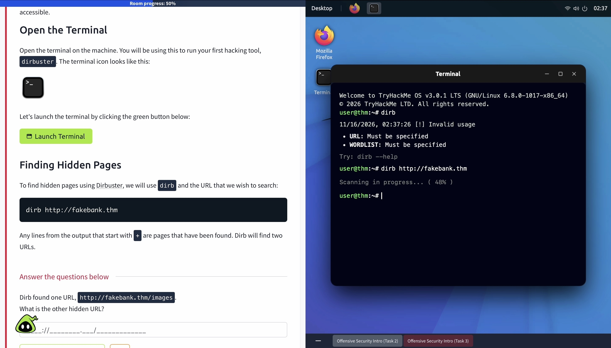
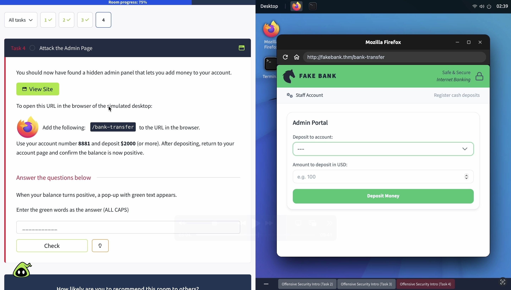
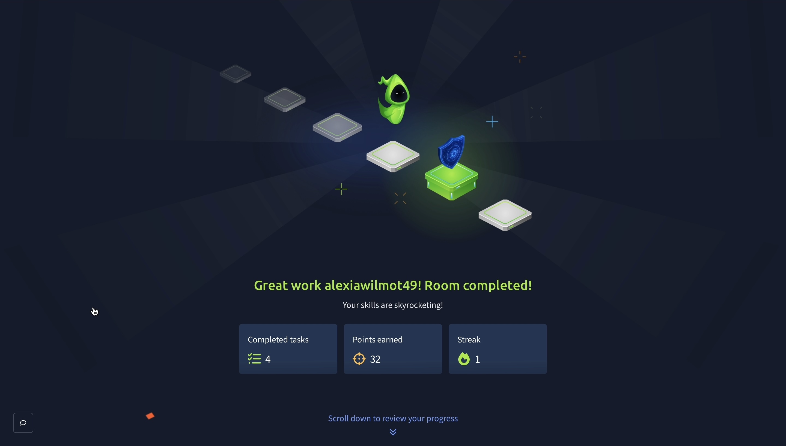

# Room 1: Offensive Security Intro (Nov 16, 2026)

**What it's about:** An introduction to Offensive Security, which means thinking like an attacker to find weaknesses 
before real attackers do. The room uses a fake banking website (FakeBank) in a safe, legal practice environment.

**What I did:**
- Opened the FakeBank site in the virtual machine and looked around the account page
- Used a tool called Dirbuster (dirb) in the terminal to scan the site for hidden pages
- My first command failed because I left out the website address. The error message told me what was missing, so I fixed
  it and ran it again
- The scan found two pages, including one that wasn't linked anywhere on the site
- Opened the hidden page and found an admin portal that let me add money to an account with no login or checks

**What I learned:**
- A hidden page is not a protected page. If it isn't linked, a scanning tool can still find it
- Admin and staff pages need proper access control
- Error messages are useful because they tell you what to fix

**Tools used:** Dirbuster, Firefox, Linux terminal

**Status:** Completed (4/4 tasks, 32 points)

