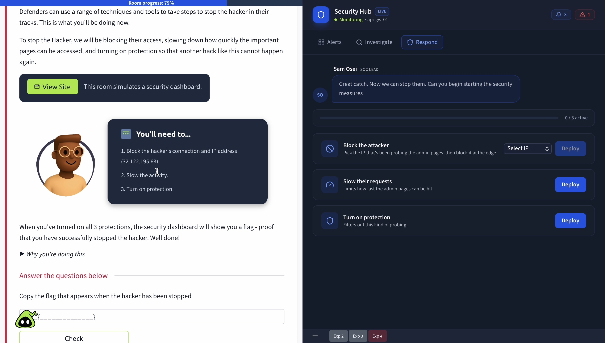
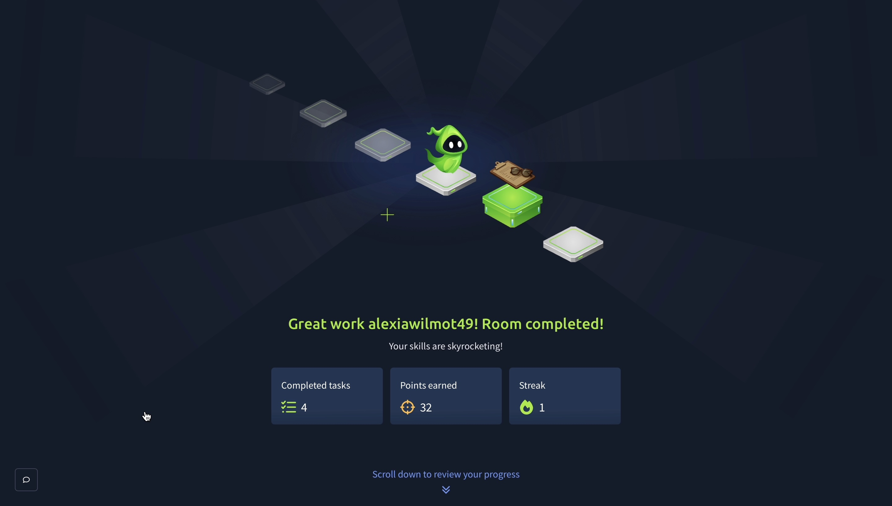

# Room 2: Defensive Security Intro (Nov 16, 2026)

**What it's about:** The other side of Room 1. Instead of attacking the fake bank, I played a defender (a security analyst) 
responding to an attack on it, using a simulated security dashboard.

**What I did:**
- Read through the alerts on the dashboard and picked out the critical one: someone was trying lots of hidden web addresses
  on the bank's site, looking for an admin page
- Investigated the alert and went through the pages the attacker had tried to open, including finding the most recent one
- Responded to the attack by deploying three protections: blocking the attacker's IP address, slowing down how fast they could
  send requests, and turning on filtering for this kind of probing
- Got confirmation that the threat was neutralised before the attacker reached anything sensitive

**What I learned:**
- Most of a defender's skill is spotting the one alert that matters among the noisy ones
- Blocking an attacker is only part of the job. Slowing them down and adding filtering stops the same thing happening again
- It connects to Room 1: the "hidden page" attack I did as the attacker is exactly what this alert was detecting

**Tools used:** Simulated security dashboard (Security Hub)

**Status:** Completed (4/4 tasks)

