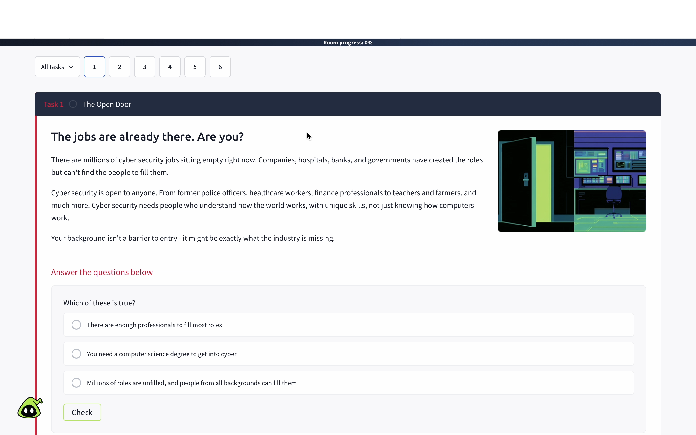
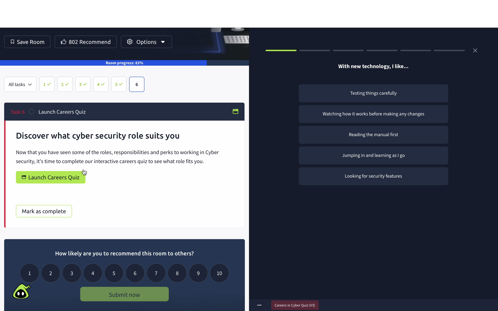
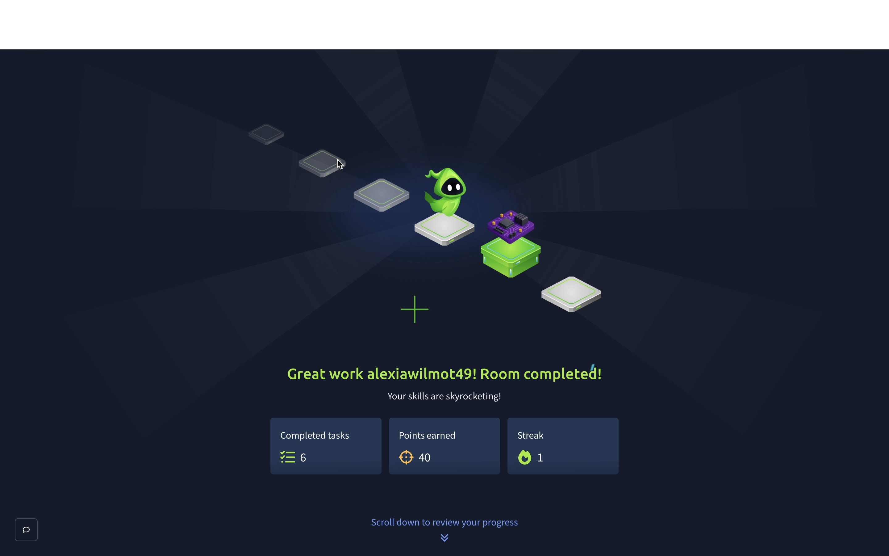
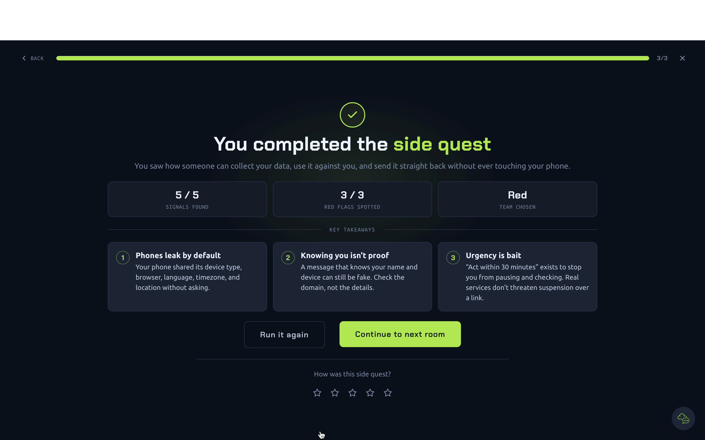

# Room 3: Careers in Cyber

**What it's about:** An introduction to careers in cyber security: what kinds of roles exist, why the field is growing, and how to find the role that fits the way you think. It ends with a short careers quiz that suggests a role based on how you approach problems.

**What I did:**
- Worked through 5 short lessons on the jobs available in cyber, what they pay, why defenders matter (hospitals, banks, power grids), the range of different roles, and where to start
- Took the careers quiz, which asks how you react to things like a computer suddenly failing, a friend's hacked email, or working on a group project
- Completed the side quest at the end: looked at a fake "new login detected" message and found all 3 red flags
- Chose a team (red or blue) at the end of the side quest

**What I learned:**
- Cyber security is not one job. There are many different roles, and the right one depends on how your mind works
- People from many different backgrounds move into the field
- Phones share a lot by default: device type, browser, language, timezone, and location
- A message that knows your name and device can still be fake. Check the sender's domain, not the details in the message
- Urgency is bait. Messages that say "act within 30 minutes" are trying to stop you from pausing and checking

**Tools used:** TryHackMe (browser), careers quiz

**Status:** Completed (6/6 tasks, 40 points)

## Screenshots

Start of the room:

The careers quiz:

Room completed:

Side quest results and key takeaways:

