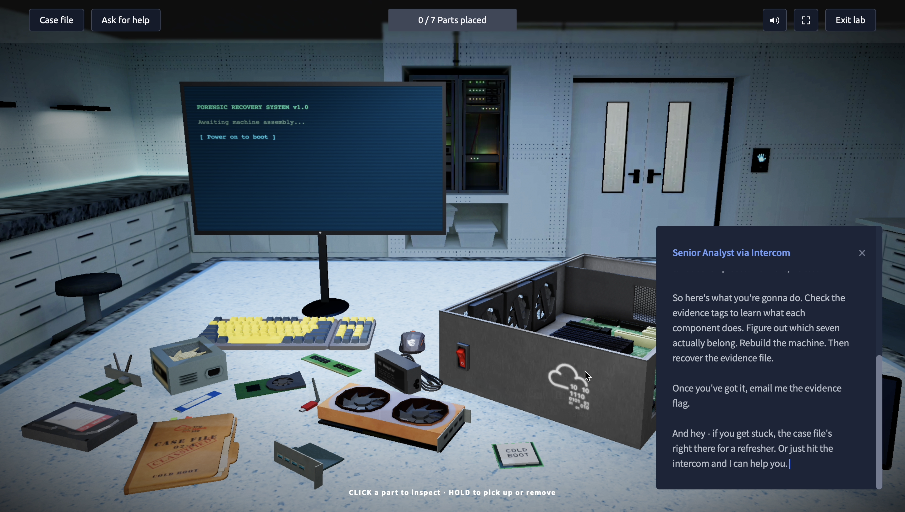
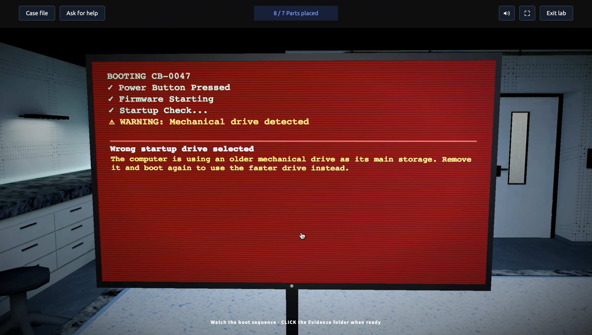
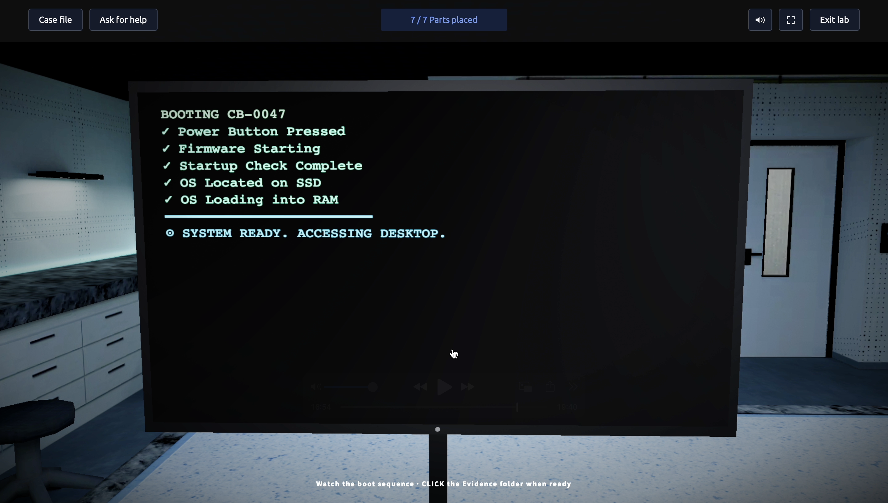
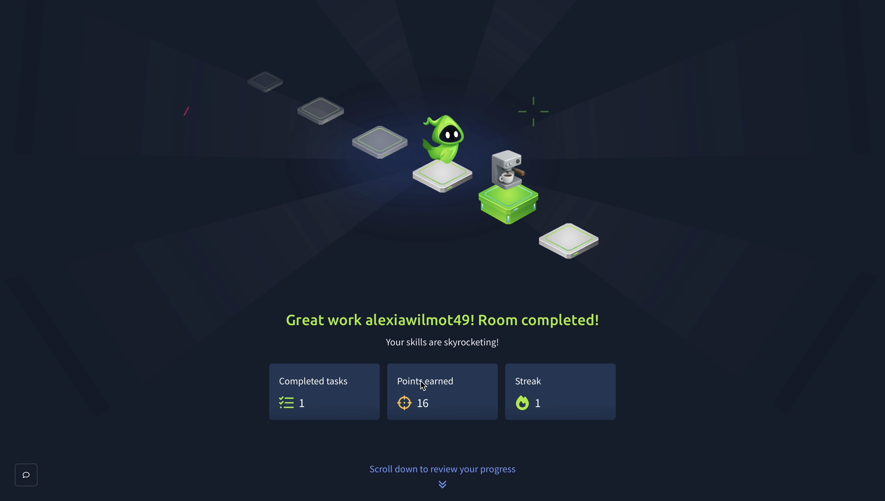

# Room 4: Cold Boot

**What it's about:** A hands-on lab about what's inside a computer and what each part does. The scenario is a forensic investigation: a workstation was pulled from a breach scene in pieces, and some of the recovered parts were decoys planted to confuse the investigators. I had to work out which parts really belonged, rebuild the machine, boot it, and find the evidence file.

**What I did:**
- Inspected each loose component and read its evidence tag to learn what it does and where it belongs
- Worked out which 7 parts belonged to the machine, since some of the parts on the table were decoys (for example, a laptop power charger doesn't belong inside a desktop)
- Assembled the machine: power supply, CPU, RAM, graphics card, storage, and network adapter
- Powered it on and troubleshot a failed boot. The screen showed a warning that an older mechanical drive was being used as the startup drive. I removed it, booted again, and the machine started from the faster drive
- Opened the evidence folder on the rebuilt machine and answered four questions about the components to verify my findings

**What I learned:**
- What the main parts do: the CPU runs every instruction, RAM temporarily holds the data in use (and loses it when power is off), the PSU converts mains power into the voltages each part needs, and the GPU produces the picture on the screen
- How a computer starts: the power button is pressed, the firmware starts, a startup check runs, the operating system is found on the drive, and it loads into RAM
- The drive the machine boots from matters. A wrong startup drive gives an error, and fixing it is a simple form of troubleshooting
- Reading the error message told me exactly what to fix, which is a habit I want to keep

**Tools used:** TryHackMe lab (browser)

**Status:** Completed (16 points)

## Screenshots

The lab at the start, with the parts laid out:

The failed boot and error message:

The machine booting successfully after the fix:

Room completed:

