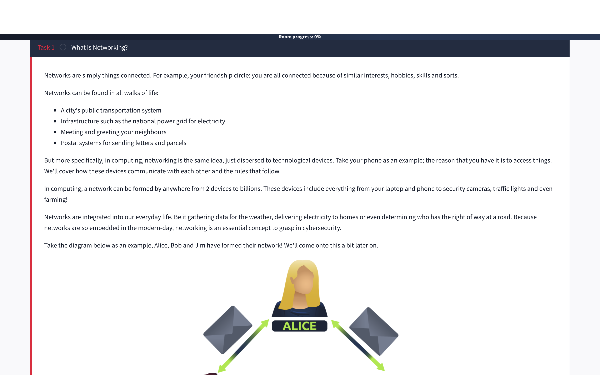
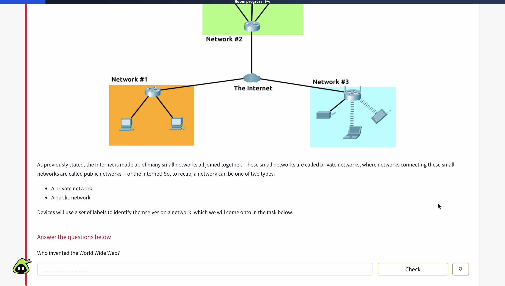
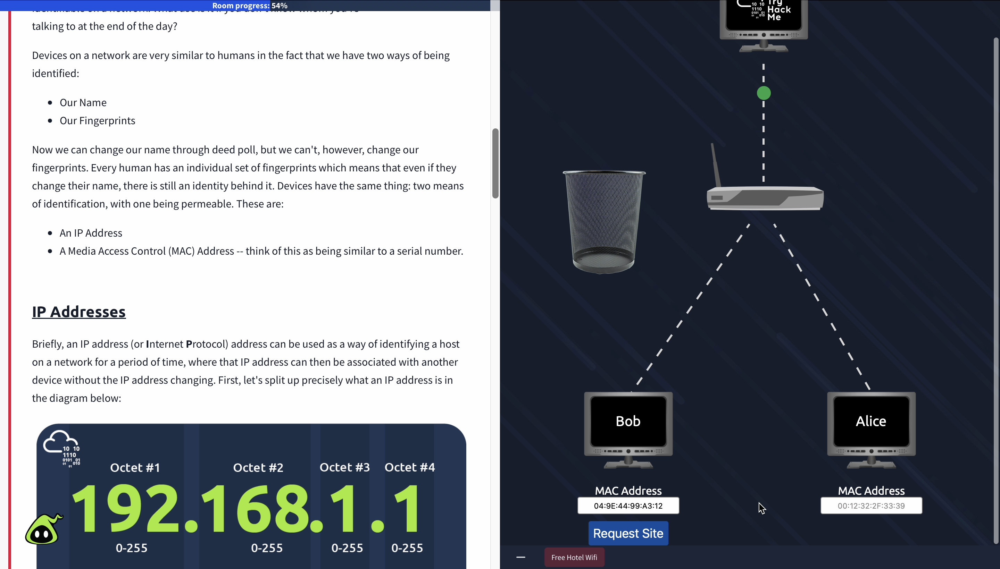
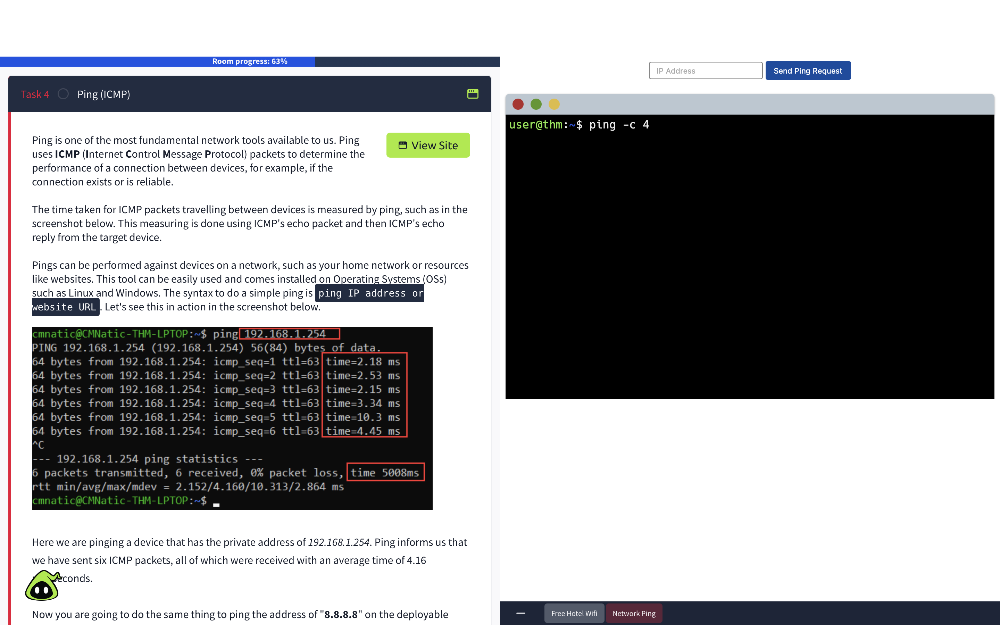
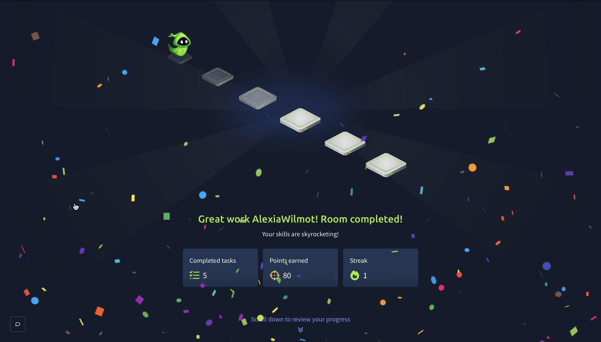

# Room 5: What is Networking?

**What it's about:** An introduction to computer networking: what a network is, the difference between private networks and the Internet, how devices identify themselves with IP and MAC addresses, and how to test a connection with ping.

**What I did:**
- Worked through short lessons on what networks are and how many small private networks join together to make the Internet
- Learned how devices are identified on a network, using IP addresses and MAC addresses, and the difference between public and private IP addresses
- Used an interactive lab that simulates a hotel Wi-Fi network, where the router only lets through devices it recognises, to see how MAC addresses can be used for access control and how they can be faked
- Used ping in a browser terminal to test the connection to a server
- Answered the questions at the end of each task

**What I learned:**
- A network is simply devices connected together, from 2 devices to billions. The Internet is a network of many smaller private networks
- An IPv4 address has four sections (octets) from 0 to 255. IPv6 was created because IPv4 is running out of addresses
- A public IP address identifies a device on the Internet, while a private one identifies it among devices on the same local network
- A MAC address is a unique 12-character hardware ID. The first half identifies the manufacturer and the second half is unique to the device
- MAC addresses can be spoofed (faked), so security that trusts a MAC address alone is weak
- Ping uses the ICMP protocol to test whether a device can be reached and how long the round trip takes. I'd used ping in my Packet Tracer projects, so this connected well to those

**Tools used:** TryHackMe (browser), interactive lab, ping

**Status:** Completed (5/5 tasks, 80 points)

## Screenshots

Start of the room:

Private networks joined by the Internet:

The hotel Wi-Fi lab:

The ping task:

Room completed:

