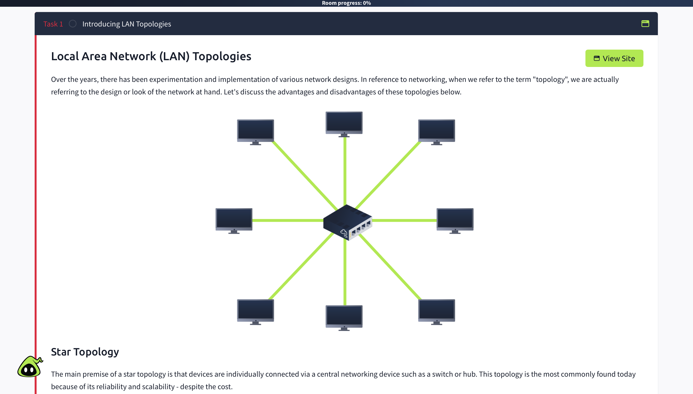
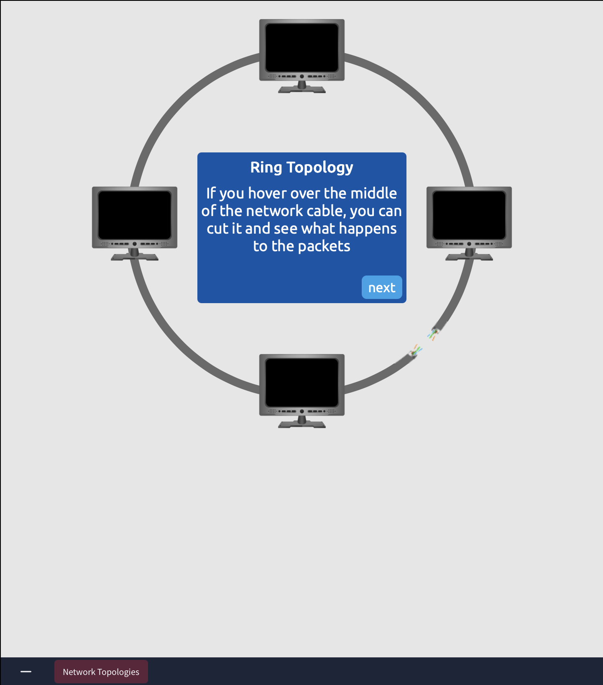
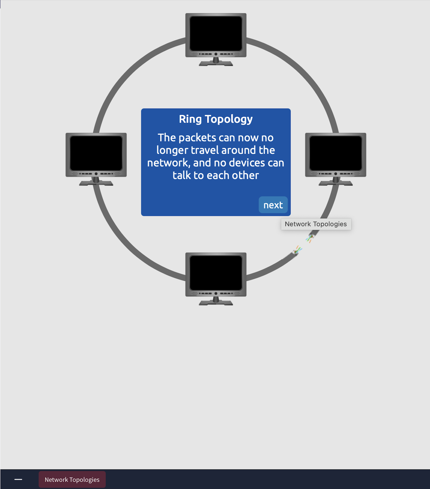
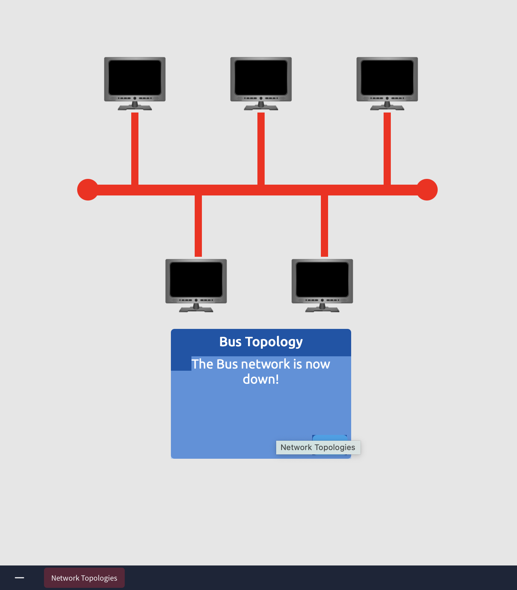
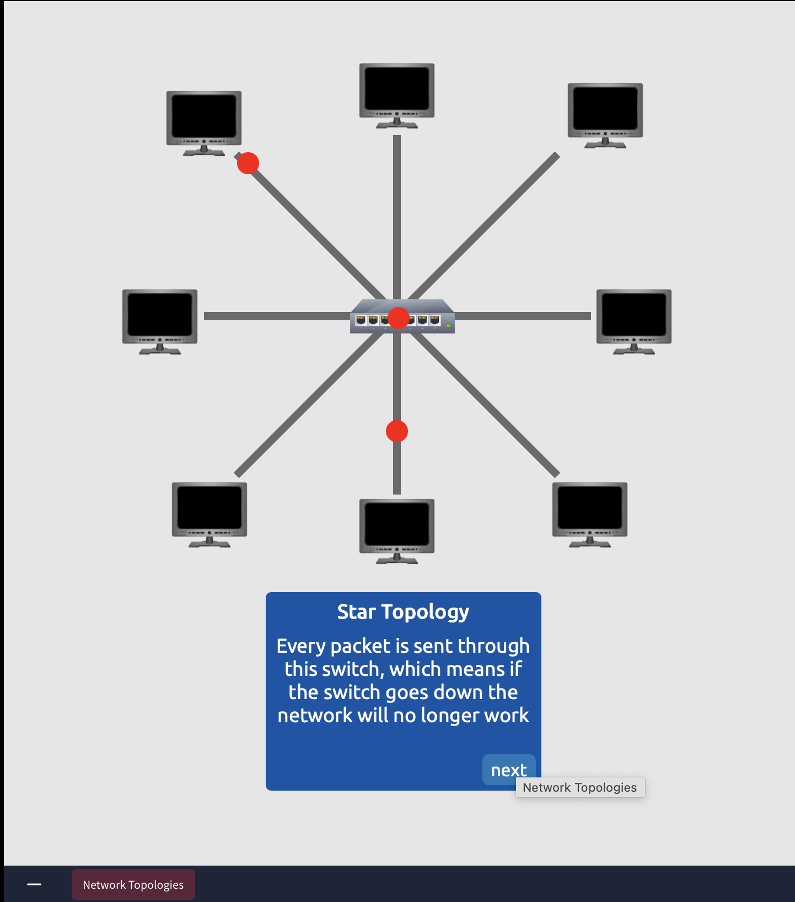
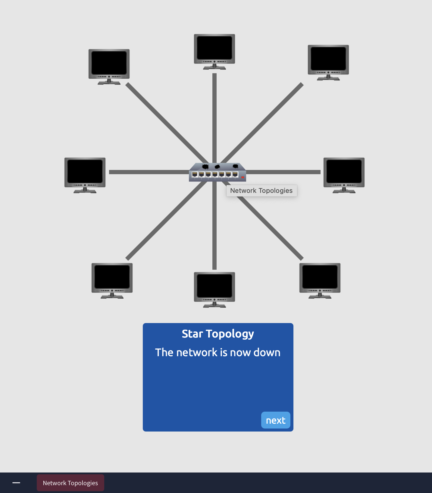
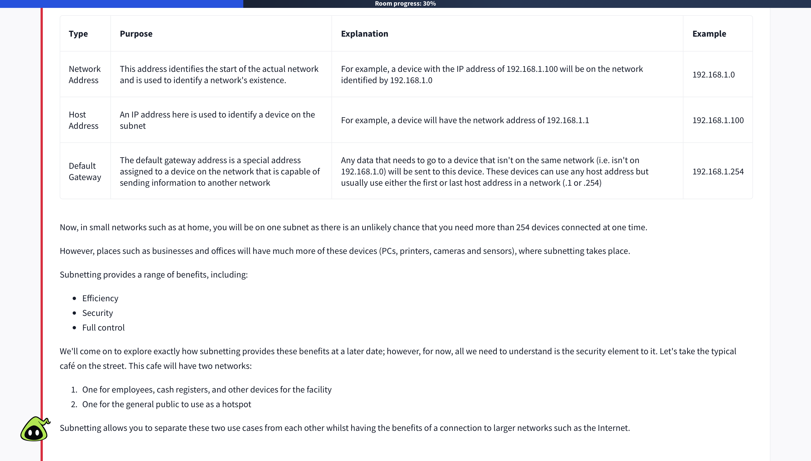
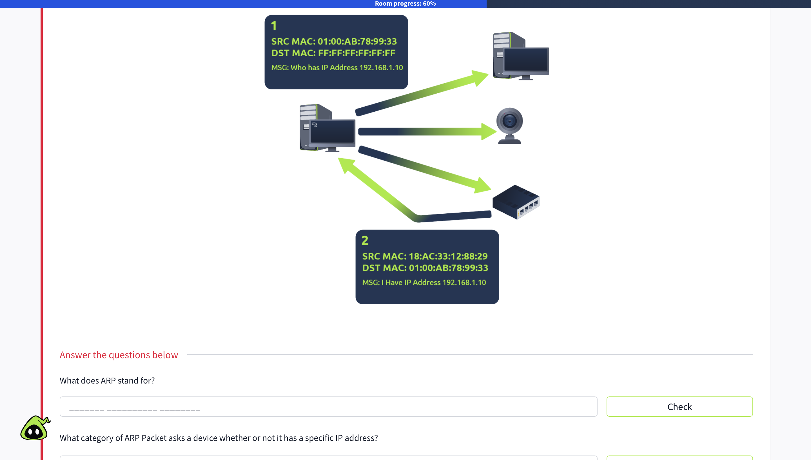
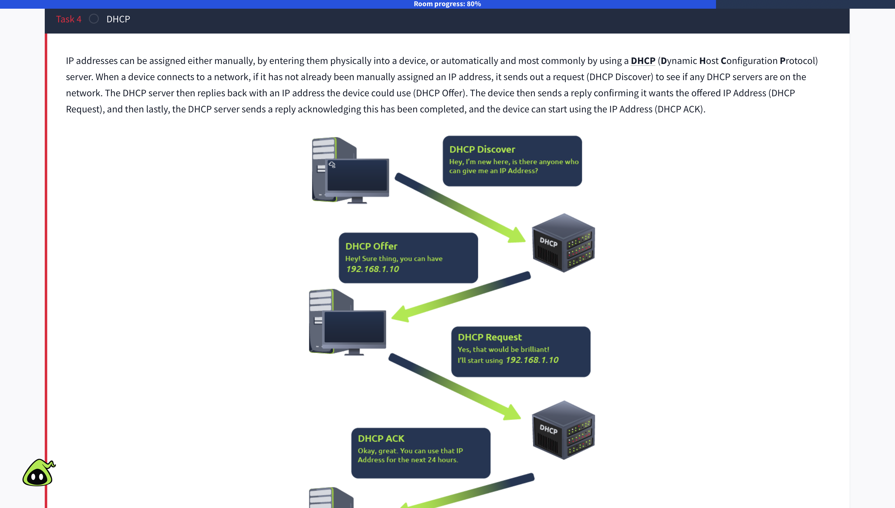
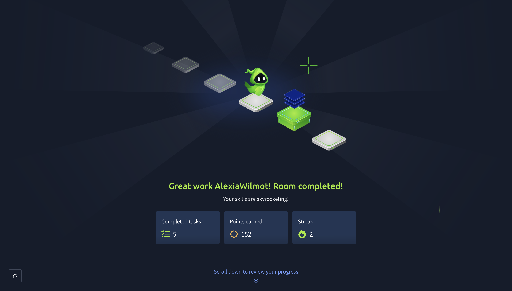

# Room 6: Intro to LAN

**What it's about:** An introduction to how local area networks (LANs) are designed and how devices on them find each other: network topologies, switches and routers, subnetting, and the ARP and DHCP protocols.

**What I did:**
- Worked through lessons on the star, bus and ring topologies, comparing cost, scalability, troubleshooting and reliability
- Learned what switches and routers do and how they differ
- Used an interactive lab to break each topology: cutting a cable in the ring, flooding the bus with packets, and taking down the central switch in the star
- Worked through a primer on subnetting, covering network addresses, host addresses and default gateways
- Studied how ARP maps IP addresses to MAC addresses and how DHCP assigns IP addresses automatically
- Answered the questions at the end of each task

**What I learned:**
- Star topology is the most common today because it is reliable and easy to scale, but it costs more and the central switch is a single point of failure
- Bus topology is the cheapest to set up, but all traffic shares one backbone cable, so it bottlenecks quickly and one cable break takes down the whole network
- Ring topology needs little cabling and is easy to troubleshoot, but a single broken cable or device breaks the entire network
- A switch sends traffic only to the intended device, while a hub repeats it to every port. A router connects separate networks and passes data between them
- Subnetting splits a network into smaller ones, which improves efficiency, security and control. A subnet mask has 32 bits, written as four octets from 0 to 255
- Every subnet has a network address (the start of the network), host addresses (the devices) and a default gateway (the device that sends data to other networks)
- ARP finds the MAC address that owns an IP address using a broadcast request and a reply, then stores the result in a cache
- DHCP hands out IP addresses automatically in four steps: Discover, Offer, Request, ACK

**Tools used:** TryHackMe (browser), interactive topology lab

**Status:** Completed (5/5 tasks, 152 points)

## Screenshots

LAN topologies overview:

Ring topology lab, cutting the cable:

Ring topology lab, network down:

Bus topology lab, network down:

Star topology lab, switch as a single point of failure:

Star topology lab, network down:

Subnetting: network, host and gateway addresses:

ARP request and reply:

The DHCP process:

Room completed:

